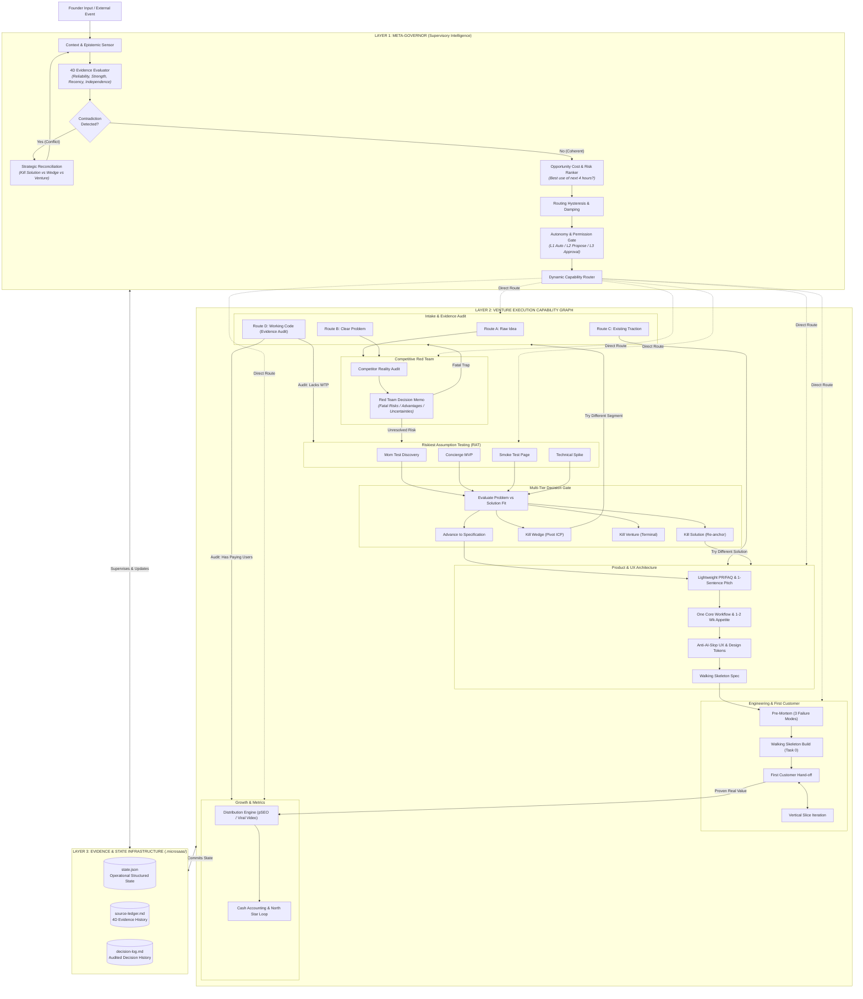
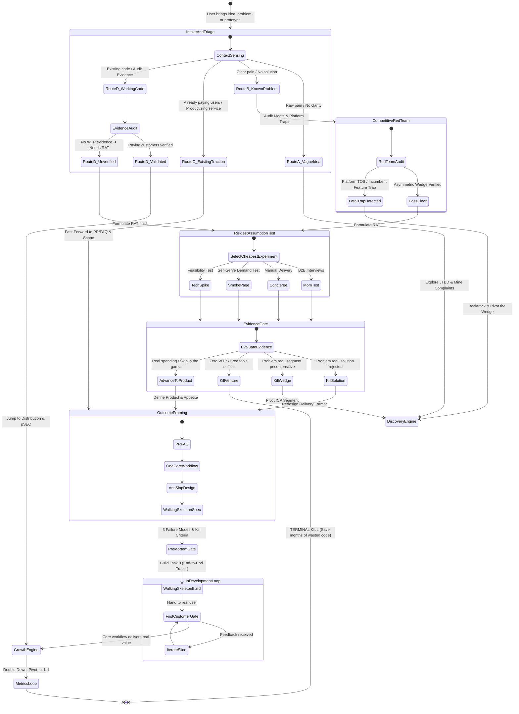

# Micro-SaaS Founder OS 🚀

> **The Idea-to-Market Agentic Operating System for Google Antigravity.**  
> *Transforming AI coding agents from reactive code generators into disciplined, evidence-driven startup co-founders.*

[](https://antigravity.google)
[](LICENSE)
[](https://python.org)
[](#the-9-stage-lifecycle)
[](#epistemic-rigor--evidence-hierarchy)

---

## 💡 The Manifesto: Zero Premature Code

The #1 reason micro-SaaS projects fail is not bad software engineering—it is **building things nobody wants or is willing to pay for**.

Traditional AI coding assistants eagerly write thousands of lines of boilerplate, scaffolding, databases, and OAuth flows for ideas that should have been killed in under 15 minutes of competitive research.

**Micro-SaaS Founder OS** enforces an unyielding discipline: **Zero code is generated until an opportunity survives adversarial red teaming, customer discovery, and willingness-to-pay validation.**

> **The Central Axiom:** Evidence before specifications. Specifications before code. Working customer value before feature expansion.

---

## 🏛️ The Three-Layer Venture Architecture

Micro-SaaS Founder OS is structured as three decoupled, interacting operational layers:
* **Layer 1: Meta-Governor (The Supervisory Brain):** Continuously senses founder input, evaluates 4D evidence confidence, checks for strategic contradictions, filters conversational noise via hysteresis, enforces autonomy permission gates, and dynamically routes to the highest-risk uncertainty.
* **Layer 2: Venture Execution Capability Graph (The Topographical Map):** Specialist venture capabilities (Discovery, Research, Validation, Product, Build, Growth, Metrics) connected by verified risk reduction.
* **Layer 3: Evidence & State Infrastructure (`.microsaas/`):** Persistent machine-readable venture state (`state.json`), calibrated 4D source ledger, and audited decision logs.

> **The Architectural Rule:** The Execution Graph determines what states and transitions are possible. The Meta-Governor determines which transition makes sense right now.



---

## 🗺️ Master Venture Execution State Machine

The complete topological map governing transitions, sub-states, and loops across the venture lifecycle:



---

## ⚖️ Meta-Governance & Decision Engine (Elite 10/10 Architecture)

To ensure execution matches architectural intent, `microsaas-hub` enforces an advanced governance framework:

### 1. The 4-Dimensional Evidence Model
Rather than a single arbitrary score, every claim is evaluated across 4 dimensions:
* **Source Reliability:** Origin trustworthiness (High: direct payment gateway / official API; Med: review sites; Low: anonymous forum rants).
* **Evidence Strength:** Directness of support (Direct cash payment vs. indirect usage vs. hypothetical survey promise).
* **Recency:** Fresh (< 6 months) vs. stale (> 12 months, pre-platform update).
* **Independence:** Independent multi-source validation vs. circular echo chambers.
* *Crucial Rule:* Evidence that a problem exists is **NOT** evidence that a proposed solution works. Both must be validated independently.

### 2. The 3-Tier Precision Termination Model
Avoids premature venture death by diagnosing the exact failure point:
* **Kill the Solution:** The problem is urgent, but the customer rejects your specific software format $\rightarrow$ Keep ICP and problem; redesign delivery (Concierge, plugin, or API).
* **Kill the Wedge:** The problem is real, but the initial niche is too small or price-sensitive $\rightarrow$ Keep core technology; pivot to an enterprise or high-budget vertical.
* **Kill the Venture:** The problem is minor, workarounds are free, and zero willingness to pay exists anywhere $\rightarrow$ Full terminal shutdown. Save months of wasted coding.

### 3. Autonomy & Permission Matrix
* **Tier 1: Autonomous (Execute & Report):** Web search, competitor mining, drafting PR/FAQs, running local tests, updating `.microsaas/state.json`.
* **Tier 2: Notification Gate (Propose & Proceed):** Proposing RAT experiments, sizing development appetite, selecting UI design archetypes.
* **Tier 3: Explicit Founder Approval (Hard Stop):** Terminating an idea (Kill Solution/Wedge/Venture), changing strategic positioning, spending real money (ads, domains), and deploying to production.

### 4. Opportunity Cost & Experiment Prioritization Engine
Before launching multi-day work, the Meta-Governor evaluates:
$$\text{Priority Score} = \frac{\text{Expected Commercial Value} \times \text{Uncertainty Reduction}}{\text{Time to Evidence} \times \text{Resource Cost}}$$
> *"Is this the best use of the founder's next 4 hours?"* A 2-hour Concierge test that eliminates fatal uncertainty beats a 3-week spec and build sprint every time.

### 5. Contradiction Detection & Strategic Reconciliation
When newly discovered research or test data conflicts with earlier premises:
* The Hub flags `⚠️ [CONTRADICTION DETECTED]`.
* Progression is frozen until an explicit [Strategic Reconciliation Memo](templates/strategic_reconciliation_memo.md) is appended to `.microsaas/decision-log.md` deciding whether to pivot the wedge, redesign the solution, or kill the venture.

### 6. Routing Hysteresis & Anti-Oscillation Damping
* **Contextual Inertia:** Clarifying questions and "what-if" musings are answered within the active skill without resetting state.
* **Materiality Threshold:** Changing the active lifecycle stage requires completing a formal gate artifact or verifying a high-confidence pivot/kill trigger.
* **Circuit Breaker:** If an idea bounces between any two skills $\ge 3$ times without producing new evidence, the Hub halts the loop and forces a binary 48-hour resolution decision.

---

## 🧩 The 7 Specialized Skills

| Skill | Role & Domain | Primary Frameworks | Strict Output / Gate |
| :--- | :--- | :--- | :--- |
| [**`microsaas-hub`**](skills/microsaas-hub/) | Master Orchestrator & State Manager | Stage-Gate, Pre-Mortem, Kill Criteria | Enforces gates, manages `.microsaas/`, stops bad builds |
| [**`microsaas-discovery`**](skills/microsaas-discovery/) | Opportunity Hunting & Idea Scoring | 4 Archetypes, Complaint Mining, JTBD | Rubric $\ge 24/35$ to advance; kills low-signal ideas |
| [**`microsaas-research`**](skills/microsaas-research/) | Competitive Moats & Red Teaming | Porter's 5 Forces, Moat Scorecard, Red Team | Moat $\ge 18/30$; exposes platform risk & incumbent traps |
| [**`microsaas-validation`**](skills/microsaas-validation/) | Riskiest Assumption Testing & Evidence | RAT, Mom Test, Concierge/Wizard of Oz | Pre-registered pass/fail falsification gates |
| [**`microsaas-product`**](skills/microsaas-product/) | PR/FAQ, Shape Up Appetite & Anti-AI-Slop UI | YC Principles, Walking Skeleton, Spec Kit | 1-Sentence Pitch, Walking Skeleton & vertical slices |
| [**`microsaas-distribution`**](skills/microsaas-distribution/) | GTM, Viral Video & Programmatic SEO | Hook-Retain-Reward scripts, pSEO matrix | 3 viral video scripts + pSEO database architecture |
| [**`microsaas-metrics`**](skills/microsaas-metrics/) | North Star Metric & 30-Day Kill Switch | AARRR Pirate Metrics, Sean Ellis PMF, Net Margin | 30-day decision memo: `DOUBLE DOWN`, `PIVOT`, or `KILL` |

---

## 🔍 Epistemic Rigor & Evidence Hierarchy

To eliminate hallucinations and unwarranted founder optimism, all skills must categorize every statement into four evidence tiers:

```text
[FACT]       ──▶ Verified empirical data (API docs, platform TOS, company registry).
[RESEARCH]   ──▶ Secondary research (G2 reviews, public pricing pages, search volume).
[SIGNAL]     ──▶ Indirect indicators (Reddit threads, founder discussions, forum rants).
[ASSUMPTION] ──▶ Founder hypothesis requiring empirical falsification before coding.
```

### ⚔️ Adversarial Red Team Rules
Before any idea receives a **GO** recommendation:
1. **The Incumbent Feature Trap:** If an established SaaS can clone the core functionality as a minor Friday sprint feature, the idea is **REJECTED**.
2. **The Platform Dependency Trap:** If the idea violates platform TOS or relies on scraping/APIs that can be revoked overnight, it is **REJECTED**.
3. **The Low Willingness-to-Pay (WTP) Trap:** If target users are accustomed to free open-source tools or complain about \$5/mo prices, it is **REJECTED**.

---

## 🎨 Distinctive UI/UX Architecture: Banishing "AI Slop"

Most AI coding agents produce apps that look like 99% of generated software: identical centered hero sections, generic `Inter` typography, clichéd purple gradients on white cards, and predictable 3-card grids.

Micro-SaaS Founder OS incorporates **[Hashim Warren's Frontend Aesthetics Directive](https://gist.github.com/hashimwarren/b544f89bdb50e4877d0e603ad547e18f)** directly into the build pipeline so generated web and mobile interfaces look bespoke, tactile, and memorable.

* **Distinctive Typography Pairings:** Ban generic `Inter`, `Roboto`, and `Arial`. Pair high-character headings (`Syne`, `Cabinet Grotesk`, `Instrument Serif`, `Clash Display`, or `Fraunces`) with refined body fonts (`Plus Jakarta Sans`, `General Sans`, `Satoshi`).
* **Cohesive Aesthetic Archetypes:** Commit to a bold, context-specific theme (*Obsidian & Phosphor* for DevTools, *Warm Atelier* for Keepsakes, *Midnight Cobalt* for Fintech, *Neo-Brutalist* for Creative tools) with defined CSS variables.
* **Atmospheric Depth & Tactile Lighting:** Layer subtle radial lighting gradients (`radial-gradient`), 28px micro-grids, or warm paper textures with crisp top rim light (`inset 0 1px 0 rgba(255,255,255,0.08)`).
* **Orchestrated Staggered Reveals:** Avoid scattered hover effects. Use pure CSS staggered page reveals on load (`animation-delay: calc(var(--index) * 80ms)`) with snappy cubic-bezier easing (`cubic-bezier(0.16, 1, 0.3, 1)`).
* **Mobile Ergonomics:** Thumb-zone CTA placement in lower third, sliding bottom sheets instead of centered modal popups, and $44 \times 44\text{px}$ minimum touch targets.

*Reference Guide:* See [`templates/frontend_aesthetics_anti_slop.md`](templates/frontend_aesthetics_anti_slop.md).

---

## ⚡ Quickstart & Installation

### Option 1: 1-Click Install to Global Antigravity Config (Recommended)

Run the included installer to copy all 7 skills directly into your global Antigravity skills directory (`~/.gemini/config/skills/`):

```bash
# On Windows / macOS / Linux
py install.py
# or
python3 install.py
```

Check installation status anytime:
```bash
py install.py --list
```

### Option 2: Project-Local Workspace Install

Install the skills strictly within your active project workspace (`.gemini/skills/`):

```bash
py install.py --workspace .
```

---

## 🛠️ Usage Walkthrough

Once installed, simply converse naturally with Antigravity. The skills activate based on your intent:

### 1. Initialize a Project & Hunt Opportunities
```text
User: "I want to explore micro-SaaS opportunities for Shopify dropshippers or physical therapists."
Agent activates: microsaas-hub -> microsaas-discovery
Output: Mined complaints, 4 archetypes evaluation, and opportunity scorecard.
```

### 2. Run Competitive Moat & Red Team Audit
```text
User: "Let's research the competition for an AI cold email personalization generator."
Agent activates: microsaas-research
Output: Competitive audit matrix, Moat Score (11/30), Adversarial Red Team verdict: NO-GO (Incumbent feature trap + TOS risk).
```

### 3. Conduct Pre-Code Customer Validation
```text
User: "How do I validate willingness-to-pay for an anniversary celestial star map keepsake?"
Agent activates: microsaas-validation
Output: Mom Test interview script, \$100 smoke-test protocol, and 14-day falsification gate.
```

### 4. Create Product Spec & PR/FAQ (Before Coding)
```text
User: "The keepsake idea validated! Let's write the spec before coding."
Agent activates: microsaas-product
Output: Amazon PR/FAQ, strict MoSCoW scope (&le; 3 features), and GitHub Spec Kit (spec.md, data-model.md, tasks.md).
```

### 5. Launch & Viral Distribution
```text
User: "We are ready to launch. Help me write TikTok/Reels video scripts and setup SEO."
Agent activates: microsaas-distribution
Output: 3 viral short-form video scripts (Hook-Retain-Reward framework) + 500-page pSEO matrix.
```

### 6. 30-Day Post-Launch Audit
```text
User: "Here are our numbers after 30 days: $2,840 GMV, $1,120 COGS, $85 Stripe fees. What's next?"
Agent activates: microsaas-metrics
Output: True Net Profit calculation ($1,635 / 57.5% net margin), Pirate metrics review, and DOUBLE DOWN roadmap.
```

---

## 📊 Scorecard & Independent Evaluation CLI

Micro-SaaS Founder OS includes a built-in evaluation engine (`tools/evaluate_system.py`) that audits project deliverables across **7 weighted dimensions**:

| Evaluation Dimension | Weight | Description |
| :--- | :---: | :--- |
| **Correctness** | 20% | Factual and technical accuracy of findings |
| **Evidence Quality** | 20% | Clear separation of facts vs assumptions with citations |
| **Decision Quality** | 20% | Soundness of GO / PIVOT / NO-GO recommendations |
| **Execution Quality** | 15% | Practical usability of templates, specs, and scripts |
| **Consistency** | 10% | Reproducible rigor across B2B, DevTools, and B2C projects |
| **State Management** | 5% | Preservation of state and decisions in `.microsaas/` |
| **Commercial Realism** | 10% | Viability of CAC, pricing, margins, and distribution channels |

### Running the Evaluator CLI
```bash
py tools/evaluate_system.py \
  --project "Stripe Webhook Sentinel" \
  --idea-verdict PIVOT \
  --idea-score "16/30 (Differentiation Gap)" \
  --correctness 9.0 \
  --evidence 8.5 \
  --decision 9.0 \
  --execution 8.5 \
  --consistency 8.5 \
  --state 8.5 \
  --commercial 8.5 \
  --output-md "scorecard.md"
```

> [!NOTE]
> The evaluator enforces a strict two-tier separation between the **Commercial Opportunity Verdict** (whether the business idea is good) and the **AI Auditor Competence Assessment** (whether the AI analyzed it correctly). An idea can be rejected (NO-GO) while the analysis receives an EXCELLENT (9.0/10) score for catching fatal flaws early.

---

## 📚 Included Examples & Benchmarks

The repository includes three real-world stress test case studies across distinct business archetypes:

* [**Case A: AI Cold Email Personalization SaaS**](examples/case_a_ai_cold_email_rejected.md) (B2B Sales)  
  *Outcome:* **🔴 REJECTED / NO-GO** (Score: 11/30). Caught in the incumbent feature trap against Instantly/Apollo and Google/Yahoo spam policy crackdowns.
* [**Case B: Stripe Webhook Reliability Sentinel**](examples/case_b_stripe_sentinel_pivoted.md) (Developer Tools)  
  *Outcome:* **🔄 PIVOT** (Score: 16/30). Pivoted from open-source clone into specialized PCI DSS audit trail for mid-market merchants.
* [**Case C: "The Night We Met" Celestial Star Map**](examples/case_c_anniversary_keepsake_approved.md) (B2C Physical Keepsake)  
  *Outcome:* **🟢 APPROVED / GO** (Score: 26/30). Validated with 58% net cash margin, zero inventory risk via print-on-demand API, and emotional gifting moat.

Also explore the [**40 Micro-SaaS Vetted Ideas Catalog**](docs/40_micro_saas_ideas_catalog.md) covering B2B workflow automation, programmatic keepsakes, niche marketplaces, and developer tools.

---

## 📑 Ready-to-Use Founder Templates

Copy-paste templates located in [`templates/`](templates/):
* `venture_state_schema.json`: Structured operational venture state schema (Layer 3).
* `opportunity_cost_evaluation.md`: 4-Hour Acid Test and experiment prioritization.
* `opportunity_scoring_rubric.md`: 7-dimension opportunity evaluation (/35).
* `competitive_audit_template.md`: Red Team Strategic Decision Memo (Fatal risks, asymmetric wedge).
* `strategic_reconciliation_memo.md`: Framework for resolving contradictions between new data and prior assumptions.
* `riskiest_assumption_test.md`: Riskiest Assumption Testing (RAT) and experiment selector.
* `mom_test_script_template.md`: Customer discovery interview script.
* `pr_faq_template.md`: Amazon-style press release and FAQ with 1-sentence pitch.
* `spec_kit_sdd_template.md`: GitHub Spec Kit for Spec-Driven Development with Walking Skeleton.
* `frontend_aesthetics_anti_slop.md`: Anti-AI-slop design directives, typography pairings, and theme tokens.
* `pre_mortem_and_kill_criteria.md`: Gary Klein Pre-Mortem (top 3 failure modes) and kill criteria.
* `short_form_video_script_template.md`: Hook-Retain-Reward TikTok/Reels script.
* `performance_review_template.md`: 30-day post-launch metrics review.

---

## 🤝 Contributing

Contributions, bug reports, and new niche templates are welcome! Please submit a pull request or open an issue.

## 📄 License

This project is licensed under the [MIT License](LICENSE).
