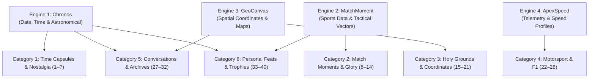

# Master Catalog: 40 Programmatic Micro-SaaS & Keepsake Concepts

**Category:** B2C Programmatic Micro-SaaS / Digital Keepsakes / Automated E-Commerce  
**Operational Target:** 100% Passive, zero-meeting delivery, automated fulfillment via Print-on-Demand (Gelato / Printful APIs).  
**Financial Target:** Portfolio approach toward €100,000 net profit/year (€8,333/month).

---

## 🏗️ The 4 Shared Technical Engines

All 40 concepts run on just **4 shared backend engines**. You build each engine once, and each concept is merely a tailored frontend landing page and SVG/Canvas template.

---

## Category 1: The "Chronos" Time-Capsule & Nostalgia Suite
*Engine: Astronomical formulas + Open-Meteo historical weather archives + Billboard music charts + Historical headlines database.*

| # | Concept Name | Target Audience & Emotional Trigger | User Input $\rightarrow$ Automated Output | Monetization Model |
| :-: | :--- | :--- | :--- | :---: |
| **1** | **The Day We Met** | Couples celebrating anniversaries, Valentine's Day, first dates. | Date + City $\rightarrow$ Minimalist framed poster of the night sky, moon phase, the #1 romantic radio song that night, and GPS coordinates. | **\$49.00** *(Print)* **\$9.99** *(PDF)* |
| **2** | **The Birth Chronicle** *(BornHere style)* | 18th, 21st, 30th, 50th, 60th milestone birthday gifts. | Date + Name + Birth City $\rightarrow$ Vintage 1920s–1990s newspaper front page with that day's news, everyday product prices, weather, and top box-office movie. | **\$39.00** *(Print)* **\$6.99** *(PDF)* |
| **3** | **The Day We Got Hitched** | Wedding anniversaries (paper, cotton, silver, gold traditions). | Wedding Date + Venue $\rightarrow$ Luxury typography certificate capturing the day's temperature, moon phase, world headlines, and custom vow excerpt. | **\$59.00** *(Framed Canvas)* |
| **4** | **Gotcha Day!** | Devoted pet owners celebrating rescue adoption anniversaries. | Pet Name + Adoption Date + City $\rightarrow$ Official "Adoption Day Celestial Map & Certificate" honoring the night their pet found a forever home. | **\$29.00** *(Print)* **\$5.99** *(PDF)* |
| **5** | **The Retirement Chronicle** | Coworkers & families buying a retirement farewell gift. | Career Start Date (e.g. 1984) to Retirement Date $\rightarrow$ Split-screen comparison: *"The World When You Started vs. The World Today"* (cost of living, tech, headlines). | **\$49.00** *(Framed Plaque)* |
| **6** | **Baby's First Night on Earth** | New parents, baby showers, and proud grandparents. | Birth timestamp + Hospital City + Weight/Height $\rightarrow$ Soft pastel watercolor star map and exact lunar illumination from the hour of birth. | **\$39.00** *(Nursery Print)* |
| **7** | **The Golden Jubilee Archive** | Adult children gifting parents on their 50th anniversary. | Wedding date 50 years ago $\rightarrow$ Gold-foiled historical digest contrasting culture, everyday prices, and headlines from 50 years ago with today. | **\$79.00** *(Metallic Foil Print)* |

---

## Category 2: The "MatchMoment" Sports & Tactical Glory Suite
*Engine: Open Football APIs + Historical Match Database + Tactical Vector Chalkboard Renderer.*

| # | Concept Name | Target Audience & Emotional Trigger | User Input $\rightarrow$ Automated Output | Monetization Model |
| :-: | :--- | :--- | :--- | :---: |
| **8** | **The 90+3' Miracle** *(Tactical Blueprint)* | Hardcore football fans obsessed with iconic goals and glory moments. | Iconic Match (e.g. Aguero 93:20, Zidane 2002, Iniesta 2010) $\rightarrow$ Minimalist blueprint poster showing dotted pass vectors, jersey numbers, and commentary quotes. | **\$45.00** *(Print)* **\$8.99** *(PDF)* |
| **9** | **My First Match at the Stadium** | Dads, moms, and kids remembering their first stadium experience. | Date + Fixture $\rightarrow$ Vintage ticket-stub plaque with match score, starting XI, weather, and the kid's name printed as "Honorary 12th Man." | **\$39.00** *(Print)* **\$6.99** *(PDF)* |
| **10** | **The Sound of the Commentary** | Fans who get emotional chills from iconic announcer audio calls. | Historic Play Call $\rightarrow$ Soundwave vector art with commentary transcript and a scannable Spotify/QR code that plays the audio clip instantly. | **\$39.00** *(Framed Print)* |
| **11** | **Fantasy League Winner & Wooden Spoon** | Millions of friends competing in FPL or NFL Fantasy leagues. | League ID / Final Standings Screenshot $\rightarrow$ Engraved metallic certificate for the Champion, and a framed "Sack of Shame" certificate for the last-place loser. | **\$35.00** *(Print)* **\$7.99** *(PDF)* |
| **12** | **The Derby / Clásico Timeline** | Fans passionate about fierce rivalries (Real-Barca, Arsenal-Spurs, Wydad-Raja). | Two Rival Clubs $\rightarrow$ 100-year rivalry infographic tracking head-to-head records, biggest blowouts, and top derby scorers in club dual-tones. | **\$42.00** *(Print)* |
| **13** | **The Invincibles Squad Tree** | Fans celebrating historic undefeated or treble-winning seasons. | Team + Legendary Season $\rightarrow$ Typographic artwork where all player names, minutes played, and match scorelines shape the championship trophy silhouette. | **\$42.00** *(Print)* |
| **14** | **The Padel / Tennis Tournament Plaque** | Growing amateur padel and tennis tournament players. | Tournament Name + Date + Partner + Score $\rightarrow$ High-end Wimbledon/Roland-Garros aesthetic commemorative championship certificate. | **\$29.00** *(Print)* **\$5.99** *(PDF)* |

---

## Category 3: The "GeoCanvas" Holy Grounds, Stadiums & Coordinates Suite
*Engine: OpenStreetMap / Mapbox Vector Tiles + Elevation APIs + Architectural Blueprint Rendering.*

| # | Concept Name | Target Audience & Emotional Trigger | User Input $\rightarrow$ Automated Output | Monetization Model |
| :-: | :--- | :--- | :--- | :---: |
| **15** | **Where I Was Sitting** | Season-ticket holders or fans who attended an unforgettable final. | Stadium Name + Section + Row + Seat Number $\rightarrow$ Architectural stadium blueprint highlighting their exact seat with a gold pin and GPS coordinates. | **\$45.00** *(Architectural Print)* |
| **16** | **The Groundhopper Passport** | Hardcore fans on a quest to visit all 92 league stadiums. | Checkboxes of visited stadiums $\rightarrow$ Minimalist map pinning every conquered stadium with completion stats (*"38/92 Grounds Visited"*). | **\$39.00** *(Poster)* **\$9.99** *(Digital Map)* |
| **17** | **First Home Coordinates** | Friends & couples celebrating a first-time home purchase. | New Home Address $\rightarrow$ Minimalist monochrome street grid centered on their roof with custom latitude/longitude and moving date. | **\$39.00** *(Framed Print)* |
| **18** | **The Marathon / Race Finisher Route** | Runners, cyclists, and triathletes finishing 10k, 21k, or 42k. | Strava / Garmin GPX file upload + Finish Time $\rightarrow$ Typography poster with full route elevation trace, kilometer splits, and official chip time. | **\$45.00** *(Print)* **\$9.99** *(PDF)* |
| **19** | **The Proposal Spot** | Newly engaged couples and Valentine's Day shoppers. | Exact Proposal Location (park, beach, viewpoint) $\rightarrow$ Monochromatic map with a delicate gold heart pinned at the coordinates. | **\$39.00** *(Print)* |
| **20** | **The Away-Day Mileage Map** | Hardcore traveling supporters following their club on tour. | Team + Season Year $\rightarrow$ Map calculating: *"Total Miles Traveled Following Newcastle Away: 8,450 km — 19 Stadiums — 42 Pints"*. | **\$39.00** *(Print)* |
| **21** | **The Mountain Summit Ascent** | Hikers who climbed Mont Blanc, Toubkal, Fuji, or Kilimanjaro. | Mountain Name + Summit Date $\rightarrow$ 3D contour topographic map showing peak elevation, hiker name, and summit coordinates. | **\$45.00** *(Print)* |

---

## Category 4: The "ApexSpeed" Motorsport & F1 Telemetry Suite
*Engine: Ergast F1 API + Open Telemetry Curves + Track Vector Layouts.*

| # | Concept Name | Target Audience & Emotional Trigger | User Input $\rightarrow$ Automated Output | Monetization Model |
| :-: | :--- | :--- | :--- | :---: |
| **22** | **The Pole Position Lap** | F1 fans obsessed with qualifying laps and telemetry data. | Circuit (Monaco, Spa, Silverstone) + Driver & Year $\rightarrow$ Track vector color-coded by gear shifts and top speed zones, with lap time down to millisecond (`1:10.166`). | **\$49.00** *(Acrylic / Print)* |
| **23** | **The Championship Decider** | Dramatic title deciders (Abu Dhabi 2021, Brazil 2008). | Iconic Race $\rightarrow$ Split-second gap tracker visual showing the lap chart and positions across the thrilling final 5 laps of the race. | **\$45.00** *(Print)* |
| **24** | **My Sim Racing / Track Day Record** | Gamers (iRacing, F1 24, Gran Turismo) & weekend track racers. | Track Name + Car Model + Personal Lap Time $\rightarrow$ Official FIA-styled Paddock Pass commemorative plaque showing their verified personal best lap. | **\$29.00** *(Print)* **\$6.99** *(PDF)* |
| **25** | **The 24 Hours of Le Mans Circuit Art** | Endurance racing fans. | Circuit de la Sarthe + Class Winner $\rightarrow$ Dark-mode night-racing map detailing corner names (Mulsanne, Porsche Curves) and total distance covered. | **\$45.00** *(Print)* |
| **26** | **The Greatest Overtake** | F1 moments (e.g. Hakkinen vs Schumacher Spa 2000). | Race + Corner $\rightarrow$ Step-by-step vector path diagram of both cars navigating the corner with driver radio quotes. | **\$39.00** *(Print)* |

---

## Category 5: The "ChatToBook" Conversations & Digital Artifacts Suite
*Engine: Chat regex parser + NLP stats + Spotify API + Soundwave vector rendering.*

| # | Concept Name | Target Audience & Emotional Trigger | User Input $\rightarrow$ Automated Output | Monetization Model |
| :-: | :--- | :--- | :--- | :---: |
| **27** | **First 1,000 Texts** | Couples preserving their early dating days (Tinder/WhatsApp). | Chat Export Text File $\rightarrow$ Typeset coffee-table book or poster displaying the very first messages, word clouds, emoji counts, and message frequency. | **\$49.00** *(Book)* **\$12.99** *(PDF)* |
| **28** | **The Group Chat Hall of Fame** | Long-standing friend groups celebrating years of banter. | WhatsApp Group Export $\rightarrow$ Magazine infographic: *"Most messages at 3 AM"*, *"Top shared memes"*, *"Total words typed"*, *"Funniest quotes"*. | **\$39.00** *(Poster)* **\$9.99** *(PDF)* |
| **29** | **Grandpa’s Voice / Heartbeat Wave** | Memorial keepsakes; preserving the voice of a late parent or baby. | 10-Second Audio File $\rightarrow$ Visual soundwave line art with a custom plaque and scannable QR code playing the voice recording. | **\$39.00** *(Print)* **\$7.99** *(PDF)* |
| **30** | **The Milestone Playlist** | Music fans commemorating their first dance or road trip. | Song Title + Artist + Photo $\rightarrow$ Acrylic glass plaque styled like a vintage vinyl or Spotify player, complete with scannable Spotify code. | **\$29.00** *(Acrylic Plaque)* |
| **31** | **The Family Year in Texts** | Busy parents who want an automatic family yearbook. | Family Group Chat (Text + Photos) $\rightarrow$ Automated typesetting engine generating a 30-page family digest book printed and shipped. | **\$49.00** *(Physical Book)* |
| **32** | **Founder’s First Commit / Slack** | Tech founders celebrating an exit, funding round, or launch. | First git commit hash or first Slack message $\rightarrow$ Terminal-aesthetic developer framed code plaque. | **\$39.00** *(Office Print)* |

---

## Category 6: The "MilestoneMeter" Personal Legend & Trophies Suite
*Engine: Metric calculation + Dynamic badge/crest rendering + SVG plaque formatting.*

| # | Concept Name | Target Audience & Emotional Trigger | User Input $\rightarrow$ Automated Output | Monetization Model |
| :-: | :--- | :--- | :--- | :---: |
| **33** | **Sobriety Milestone Plaque** | People celebrating 100 days, 1 year, or 5 years sober (deeply proud). | Sobriety Start Date $\rightarrow$ Heavyweight gold-accented certificate calculating exact days, hours, and minutes of clean time with a custom affirmation. | **\$39.00** *(Framed Plaque)* **\$6.99** *(PDF)* |
| **34** | **Debt-Free / Mortgage Burn Day** | Homeowners or grads paying off student debt or a 25-yr mortgage. | Payoff Date + Amount Eliminated $\rightarrow$ Vintage "Certificate of Financial Freedom" to hang in the paid-off home. | **\$29.00** *(Print)* **\$5.99** *(PDF)* |
| **35** | **The 100-Game Fan Veteran** | Season-ticket holders who’ve racked up 50 or 100 live matches. | Match List / Years Attending $\rightarrow$ *"Certified Club Veteran: 100 Matches Attended Across 12 Years"*, listing the biggest historical wins witnessed live. | **\$49.00** *(Framed Plaque)* |
| **36** | **The GOAT Debate Tale of the Tape** | Fans debating Messi vs Ronaldo, Jordan vs LeBron, Senna vs Prost. | Two Legends $\rightarrow$ Boxing-style "Tale of the Tape" infographic comparing career goals, assists, trophies, clutch stats, and longevity. | **\$35.00** *(Print)* **\$6.99** *(PDF)* |
| **37** | **Youth League "Rookie Card" Poster** | Proud parents whose 8- to 12-year-old just finished a sports season. | Photo + Jersey Number + Team + Stats $\rightarrow$ Giant high-gloss Panini/Topps style rookie trading card poster for their bedroom wall. | **\$39.00** *(Gloss Print)* |
| **38** | **The 100-Book Reader Bookshelf** | Avid readers tracking books on Goodreads. | List of book titles/covers read in a year $\rightarrow$ Aesthetic miniature bookshelf poster showing every single book spine read in 2026. | **\$39.00** *(Poster)* **\$8.99** *(PDF)* |
| **39** | **First Hole-in-One Certificate** | Golfers hitting a rare, once-in-a-lifetime hole-in-one. | Course Name + Hole # + Yardage + Club + Witnesses $\rightarrow$ Traditional country-club official commemorative plaque. | **\$49.00** *(Framed Plaque)* |
| **40** | **The \$100k ARR / Indie Trophy** | Indie hackers hitting revenue milestones ($10k MRR, $100k ARR). | Milestone Date + Stripe Screenshot $\rightarrow$ Matte-black physical plaque modeled after YouTube Creator Play Buttons. | **\$79.00** *(Metallic Plaque)* |

---

## 📈 Studio Unit Economics to Reach €100,000 Net Profit

| Scenario | Average Net Margin / Sale | Sales Needed / Year | Sales Needed / Month | Daily Sales Across Portfolio |
| :--- | :---: | :---: | :---: | :---: |
| **100% Digital ($6.99 PDF)** | ~$5.90 | 16,950 sales | 1,412 sales | ~47 sales / day |
| **Hybrid (50% Digital / 50% Framed Print)** | ~$16.50 | 6,060 sales | 505 sales | **~17 sales / day** |
| **100% Framed Print ($45–$59 via Gelato)** | ~$26.00 | 3,846 sales | 320 sales | **~10 sales / day** |

*Across a portfolio of 10 active storefronts, **10 sales a day** equals just **1 single sale per app per day**.*
