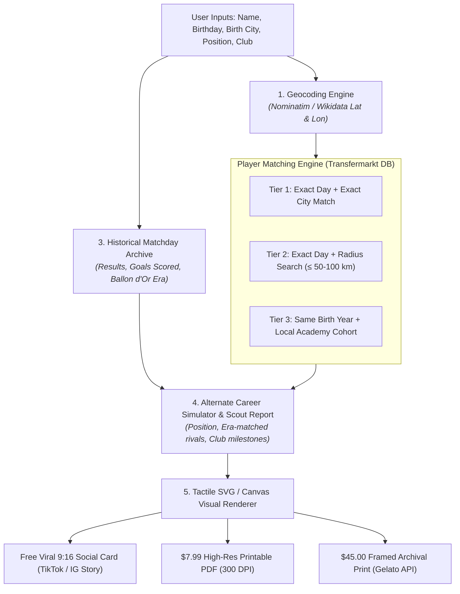

# Concept Blueprint: `ProTwin` / `The Alternate XI` ⚽
### The "What If I Made It Pro?" Birthday & Hometown Career Dossier

> **Archetype:** B2C Programmatic Micro-SaaS & Keepsake / High-Margin Gifting  
> **Core Desire:** Identity, nostalgia, ego, and the universal football fan fantasy: *"What if a scout had spotted me in my hometown?"*  
> **Operational Target:** 100% automated delivery via web preview, digital unlock ($7.99), and Print-on-Demand framed prints ($45.00) via Gelato API.

---

## 🌟 1. The Core Value Proposition & Emotional Hook

Every football fan who ever kicked a ball on a school playground or local pitch has had the daydream:
> *"What if I was born in the same academy system as the pros? What if I came through my hometown club at 17? What would my career have looked like?"*

**`ProTwin`** turns this universal fantasy into a personalized, data-backed keepsake:
1. **The User Enters:** Full Name, Date of Birth (`DD/MM/YYYY`), Hometown/City of Birth, Preferred Playing Position (e.g. Striker, Winger, Box-to-Box Midfielder), and Favorite Club.
2. **The Engine Matches:**
   - **Your Birthday Pro Twin:** The real professional footballer born on your exact birthday in your city (or within $\le 50$ km radius).
   - **Matchday History on Your Birth Date:** What major league/world cup matches were played on the day you were born? Who scored? How many total goals were scored across football that weekend?
   - **Your Alternate Pro Career Arc:** An AI-generated, hyper-realistic fictional scout report and career timeline showing the parallel career you could have lived if you signed for your local club in that era.
3. **The Deliverable:** A stunning, vintage-styled **Matchday Programme Cover**, **1990s Panini-style Rookie Card**, or **Retro Sports Magazine Cover** ready to share on social or frame on the wall.

---

## 🏗️ 2. The 3-Tier Technical Engine & Data Pipeline

### Data Sources (100% Feasible & Cost-Effective):
1. **Player Database (`transfermarkt-datasets`):**
   - Open-source dataset on GitHub (`dcaribou/transfermarkt-datasets`) and Kaggle (`player-scores`).
   - 60,000+ professional football player profiles with `date_of_birth`, `city_of_birth`, `country_of_birth`, and complete transfer/club history.
   - Filterable in local SQLite / PostgreSQL with sub-millisecond query performance.
2. **Geographic Proximity (Haversine Formula):**
   - Resolves small towns without exact pro matches to the nearest football hub within $X$ km.
3. **Historical Matchday Records:**
   - `football-data.co.uk` and RSSSF open match archives for historical fixtures, scorelines, and top goalscorers on that exact date.

---

## 🎨 3. Anti-AI-Slop Visual Styling (The Deliverables)

Generic AI images look plastic and fake. `ProTwin` uses **bespoke editorial layout templates**:

* **Aesthetic 1: The 1990s Matchday Programme**
  - Weathered paper texture, authentic halftone dot-screen print effect, bold serif header (*Fraunces* or *Clash Display*).
  - Headline: *"NEW HOMETOWN SIGNING: [User Name] JOINS THE FIRST TEAM!"*
  - Corner badge: Official birthday twin stats & historic matchday scorelines.
* **Aesthetic 2: The Vintage Foil Rookie Card**
  - Panini-style collectible card design with gold-foil border, player stats box (Pace, Shooting, Vision, Passing), and local club colors.
* **Aesthetic 3: The European Sports Magazine Cover**
  - L'Équipe / FourFourTwo editorial aesthetic featuring a stylized monochrome portrait cutout, retro typography, and alternate career timeline milestones.

---

## 💰 4. Unit Economics & Pricing Tiers

| Tier | Price | COGS / Fees | Net Cash Profit | Gross Margin |
| :--- | :---: | :---: | :---: | :---: |
| **Free Social Hook** | **\$0.00** | \$0.01 *(Compute)* | -\$0.01 | *Acquisition Hook* |
| **High-Res PDF Unlock** | **\$7.99** | \$0.53 *(Stripe fee + API)* | **\$7.46** | **93.3%** |
| **Framed Print (30x40cm)** | **\$45.00** | \$21.50 *(Gelato POD + Ship)* + \$1.60 *(Stripe)* | **\$21.90** | **48.7%** |

*Target AOV with 1-click gift card upsell:* **\$28.50**.

---

## ⚔️ 5. Adversarial Red Team Audit & Trap Mitigations

### 1. The Trademark & Club Licensing Trap:
* **The Risk:** Premier League, UEFA, and individual clubs aggressively defend their crests, logos, and jersey designs. Slapping an official Chelsea or Real Madrid logo on a poster will trigger Cease & Desist letters.
* **The Solution:** **Classic Retro Heraldry & Factual Fair Use.** Use traditional vintage heraldic shield silhouettes, retro geometric stripes in club colors (e.g. Royal Blue & White, Claret & Sky Blue), and factual editorial history (*"Played at Highbury, London — 1998 to 2004"*). Never use copyrighted crests or trademarked slogans.

### 2. The "Small Village / No Pro Born Here" Problem:
* **The Risk:** A user born in a 2,000-person village in rural Devon or Iowa will find zero pro players born in that exact village on that exact day.
* **The Solution: 3-Tier Distance Fallback:**
  - **Tier 1 (Exact):** Same day + same city.
  - **Tier 2 (Regional Twin):** Same day + nearest city within $\le 50-100$ km (*"Your Regional Pro Twin born 24 km away in Bristol"*).
  - **Tier 3 (Academy Cohort):** Same birth year & month + local club youth intake.
  - *Guarantee:* Every user always receives a rich, populated, fascinating dossier.

---

## 🚀 6. Go-To-Market & Viral Loop

### The TikTok / Instagram Story Hook:
* **Script:** *"I found out who was born in my exact town on the exact day I was born... While he signed for Lyon at 17, I ended up working in Excel. Here is my alternate pro football career timeline."*
* **Viral Mechanic:** Users tag their mates: *"Who's your birthday twin?"* and share their 9:16 card in group chats.
* **Programmatic SEO (pSEO):**
  - Matrix: `/birthday-twin/{month}-{day}` and `/born-to-play/{city}`
  - Captures high-intent searches: *"footballers born on October 24"*, *"famous athletes from Leeds"*, *"unique 30th birthday gifts for football fans"*.
