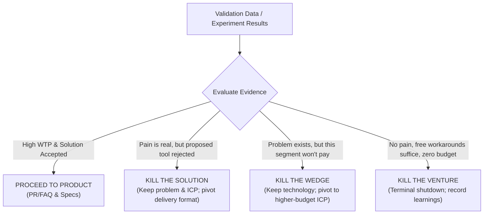

# Micro-SaaS Idea Validation & Evidence Ledger (`microsaas-validation`)

Use this skill to convert theoretical hypotheses into **observable commercial facts**. Never write a single line of application code without tangible proof that target customers experience real pain and are willing to commit time, reputation, or money to solve it.

> **Core Principle:** Validate demand before validating your ability to build software. Disambiguate problem validation from solution validation.

---

## 🎯 Step 1: The Riskiest Assumption Test (RAT)

Before designing any experiment or writing code, isolate the single assumption that could kill the business if false.

### The 4 Assumption Categories:
1. **Problem Assumption:** Target users actually suffer from this pain repeatedly and care enough to fix it.
2. **Willingness-to-Pay (WTP) Assumption:** Users actively allocate budget or spend money on workarounds (not just looking for free tools).
3. **Distribution / Reachability Assumption:** We can cost-effectively reach these specific users where they already congregate.
4. **Feasibility / Dependency Assumption:** The core technical value can be delivered without violating platform terms or relying on fragile hacks.

### ⚠️ Crucial Disambiguation: Problem Fit $\neq$ Solution Fit
* **Problem Validation:** *"Do you have this specific headache, and how much did your last workaround cost?"*
* **Solution Validation:** *"Does our proposed approach actually solve it without introducing new friction?"*
* **Warning:** A prospect experiencing severe pain does *not* automatically want your proposed software solution. They may prefer an employee, a spreadsheet, or an agency. Always validate both independently.

---

## 🔬 Step 2: The 4-Dimensional Evidence Model

Evaluate all incoming validation data across 4 dimensions:

| Dimension | Evaluation Criteria | Example Strong Signal | Example Weak Signal |
| :--- | :--- | :--- | :--- |
| **Source Reliability** | Origin trustworthiness | Direct video interview with purchasing manager | Anonymous Reddit post |
| **Evidence Strength** | Directness of support | Verified \$50 pre-order deposit | Survey answer: "Looks cool, would buy" |
| **Recency** | Temporal relevance | Incurred expense within last 30 days | Paid for a tool 3 years ago |
| **Independence** | Freedom from echo chambers | 5 unrelated clinics across 3 cities | 3 colleagues from the same Slack channel |

---

## 🛠️ Step 3: Choose the Cheapest Meaningful Experiment

Select the experiment that directly tests your **Riskiest Assumption** with the least effort:

```text
┌────────────────────────────────────────────────────────────────────────┐
│                      THE 5 VALIDATION EXPERIMENTS                      │
├─────────────────────────┬──────────────────────────────────────────────┤
│ 1. THE MOM TEST         │ Best for: B2B workflow & productivity tools. │
│    (5–8 Interviews)     │ Validates past spending, frequency, and      │
│                         │ active workarounds without pitching.         │
├─────────────────────────┼──────────────────────────────────────────────┤
│ 2. CONCIERGE MVP        │ Best for: Data extraction, auditing, and     │
│    (Manual Delivery)    │ niche reporting. Manually deliver the result │
│                         │ for 3–5 clients before writing any code.     │
├─────────────────────────┼──────────────────────────────────────────────┤
│ 3. WIZARD OF OZ MVP     │ Best for: AI tools & interactive workflows.  │
│    (Simulated Backend)  │ Front-facing form / UI simulates automation, │
│                         │ while founder manually executes the logic.   │
├─────────────────────────┼──────────────────────────────────────────────┤
│ 4. PAID PILOT / PRE-PAY │ Best for: High-ticket B2B micro-SaaS.        │
│    (Letter of Intent)   │ Customer puts down a refundable deposit or   │
│                         │ signs a 3-month pilot agreement.             │
├─────────────────────────┼──────────────────────────────────────────────┤
│ 5. SMOKE TEST PAGE      │ Best for: Self-serve B2C/B2B & keepsakes.    │
│    (Real Price + Click) │ Landing page with exact price tag & Stripe   │
│                         │ checkout click tracking (zero backend code). │
└─────────────────────────┴──────────────────────────────────────────────┘
```

---

## 📋 The Mom Test Protocol (Customer Discovery)

When speaking with potential users, adhere strictly to Rob Fitzpatrick's rules:
1. **Talk about their life and past actions, not your idea.**
2. **Ask about specific instances in the past, never generalities or hypotheticals.**
3. **Listen 80% of the time, speak 20%.**

### The 5 Essential Mom Test Questions:
1. *"When was the last time you had to deal with [problem]?"* (Recency & frequency).
2. *"Can you walk me through what you did step-by-step to handle it?"* (Workflow & friction).
3. *"What other solutions or tools did you try before settling on this?"* (Active search behavior).
4. *"What do you dislike about your current setup, and what does that workaround cost you in time or money?"* (Severity).
5. *"In the past 12 months, have you paid for any software, freelancer, or tool to help fix this?"* (Willingness to pay).

---

## 🛑 Step 4: The 3-Tier Decision Gate (Precision Killing)

When validation results arrive, avoid blunt terminal decisions. Apply the **3-Tier Decision Model**:



1. **Pass (Skin in the Game):** Prospects demonstrate willingness to pay (paid deposits, confirmed past software spend, or signed pilot). $\rightarrow$ **Advance to `microsaas-product`**.
2. **Kill the Solution:** The problem is urgent and customers spend money, but they reject your proposed software interface (e.g. they want a spreadsheet plugin, not another dashboard). $\rightarrow$ **Redesign the solution format without abandoning the opportunity**.
3. **Kill the Wedge:** The problem is valid, but the target niche is too small or price-sensitive. $\rightarrow$ **Pivot the ICP to an enterprise or well-funded vertical**.
4. **Kill the Venture:** Extensive interviews reveal the problem is minor, users are happy with free workarounds, and zero commercial intent exists anywhere. $\rightarrow$ **Terminal Shutdown. Save months of wasted coding.**

---

## 📄 Required Output Artifact

Save all observable outcomes in `validation-ledger.md`:
* The isolated Riskiest Assumption and chosen experiment.
* 4D Evidence Ratings for every cited customer interaction.
* Problem Fit vs Solution Fit assessment.
* Decision Gate Verdict: **PROCEED TO PRODUCT / KILL SOLUTION / KILL WEDGE / KILL VENTURE**.
* Human Sign-Off Checkpoint.
