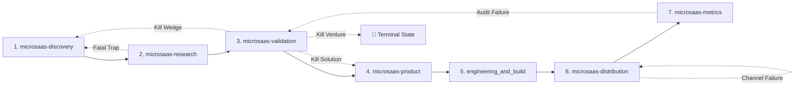

# Layer 2 Capability Transition Contracts Specification

> **Architectural Law:** The Execution Graph defines what states and transitions are valid. The Meta-Governor selects the next transition based on evidence and risk.  
> Every capability in the execution graph operates under a formal contract: **Inputs, Preconditions, Outputs, Evidence Requirements, State Mutations (`state.json`), Machine-Readable Results (`templates/capability_result_schema.json`), Exit Conditions, and Failure Handling**.

---

## 🗺️ Capability Contract Catalog



---

## 🎯 Precise Hypothesis-Specific Falsification Mapping

A blunt "experiment failed $\rightarrow$ kill venture" is catastrophic. The Meta-Governor identifies precisely which hypothesis was tested and failed before triggering a state transition:

```text
┌───────────────────────────────┬───────────────────────────────┬────────────────────────────────────────────┐
│ Falsified Hypothesis Type     │ Root Cause Diagnosis          │ Precise Corrective Transition              │
├───────────────────────────────┼───────────────────────────────┼────────────────────────────────────────────┤
│ 1. Problem Hypothesis         │ Pain is trivial / Free tools  │ KILL VENTURE (Terminal shutdown)           │
│ 2. Solution Hypothesis        │ Real pain, but tool rejected  │ KILL SOLUTION (Redesign UX / Delivery)     │
│ 3. Wedge / ICP Hypothesis     │ Pain exists, but segment broke│ KILL WEDGE (Reposition ICP to high-budget) │
│ 4. Acquisition Channel Hypo   │ Good product, poor channel fit│ PIVOT CHANNEL (Test organic vs paid vs SEO)│
│ 5. Pricing / Packaging Hypo   │ Love tool, hate subscription  │ PIVOT PRICING (Test LTD / Usage / Annual)  │
│ 6. Retention Hypothesis       │ Day-1 value, no habit trigger │ REVISE CORE LOOP (Re-engineer triggers)    │
└───────────────────────────────┴───────────────────────────────┴────────────────────────────────────────────┘
```

---

## 📑 Standardized Machine-Readable Output Format

Every capability execution produces a JSON document matching `templates/capability_result_schema.json`:

```json
{
  "capability": "microsaas-validation",
  "execution_id": "exec_2026_014",
  "timestamp": "2026-11-04T16:45:00Z",
  "status": "completed",
  "decision": "pivot_solution",
  "focal_hypothesis_id": "HYP-SOL-01",
  "hypothesis_status": "falsified",
  "evidence_references": ["LEDGER-EV-04", "LEDGER-EV-05"],
  "confidence_assessment": {
    "reliability": 0.85,
    "strength": 0.80,
    "recency": 0.95,
    "independence": 0.70
  },
  "unresolved_risks": ["EHR API integration security review required"],
  "next_recommended_capability": "microsaas-product",
  "requires_founder_approval": false,
  "artifacts_produced": [".microsaas/mom_test_transcript.md"]
}
```

---

### Contract 1: `microsaas-discovery`
* **Purpose:** Opportunity hunting, problem space mapping, ICP identification, and unbundling.
* **Inputs:** Founder domain interest, raw idea, customer rant threads, forum search terms.
* **Preconditions:** None (Entry point for Route A & Route B).
* **Operational Execution:**
  - Mine Reddit, G2, Trustpilot for recurring complaints.
  - Define 1-Sentence Problem Statement & Target Persona.
  - Score opportunity using Opportunity Scoring Rubric ($\ge 18/30$ to proceed).
* **Output Artifacts:** `opportunity_brief.md`, updated `source-ledger.md`.
* **State Mutations (`state.json`):**
  - `maturity_stage`: `"discovery"`
  - `active_capability`: `"microsaas-discovery"`
  - `active_hypotheses`: Append initial Problem Hypothesis `HYP-PROB-01`.
* **Exit Conditions:** Validated problem statement and narrow target customer defined.
* **Failure Handling:** If opportunity scores $< 18/30$, archive in `decision-log.md` and select alternative idea candidate.

---

### Contract 2: `microsaas-research`
* **Purpose:** Competitive intelligence, platform risk audit, and asymmetric advantage formulation.
* **Inputs:** Target customer niche, proposed value proposition, competitor URLs.
* **Preconditions:** Validated problem statement in `state.json`.
* **Operational Execution:**
  - Audit 3–5 direct and indirect competitors.
  - Analyze incumbent vulnerabilities (pricing, bloat, API locks).
  - Draft Strategic Red Team Decision Memo (Fatal Risks, Advantages, Uncertainties).
* **Output Artifacts:** `competitive_audit.md`, updated `source-ledger.md`.
* **State Mutations (`state.json`):**
  - `maturity_stage`: `"research"`
  - `active_capability`: `"microsaas-research"`
  - `verified_facts`: Append competitor pricing and platform API constraints.
* **Exit Conditions:** Red Team Memo signed off with explicit `GO` or `PIVOT`.
* **Failure Handling:**
  - If Fatal Platform Risk detected $\rightarrow$ Route back to `microsaas-discovery` (re-position wedge).
  - If Unresolved Critical Uncertainty $\rightarrow$ Route directly to `microsaas-validation` (RAT).

---

### Contract 3: `microsaas-validation`
* **Purpose:** Pre-code Riskiest Assumption Testing (RAT) and demand verification.
* **Inputs:** Critical assumption from Red Team Memo or intake audit.
* **Preconditions:** Hypothesis articulated; EIPH heuristic score calculated.
* **Operational Execution:**
  - Select RAT experiment type: Mom Test Calls (5–8), Smoke Page, or Concierge MVP.
  - Execute 4-Hour proxy experiment if possible.
  - Evaluate 4D Evidence: Source Reliability, Evidence Strength, Recency, Independence.
* **Output Artifacts:** `mom_test_transcript.md` or `rat_results.md`, updated `source-ledger.md`.
* **State Mutations (`state.json`):**
  - `maturity_stage`: `"validation"`
  - `active_capability`: `"microsaas-validation"`
  - `experiments`: Record experiment id, sample size, and quantitative results.
  - `verified_facts`: Record validated customer willingness-to-pay or rejection data.
* **Exit Conditions:** Measurable pass criteria achieved (e.g., $\ge 3/5$ confirm hair-on-fire pain and past spend).
* **Failure Handling:** Use Hypothesis-Specific Falsification Mapping (Kill Solution vs Kill Wedge vs Kill Venture).

---

### Contract 4: `microsaas-product`
* **Purpose:** PR/FAQ drafting, single-workflow scoping, anti-slop UX tokens, and Walking Skeleton spec.
* **Inputs:** Validated problem-solution fit from `microsaas-validation` or passed Service Audit (Route C).
* **Preconditions:** Tier 3 Founder sign-off on RAT validation results.
* **Operational Execution:**
  - Write Amazon-style PR/FAQ with 1-Sentence Pitch.
  - Define One Core Workflow ($\le 60$ seconds to value).
  - Lock Shape Up development appetite ($\le 1–2$ weeks).
  - Define Design Tokens and Anti-AI-Slop visual aesthetic rules.
  - Author Spec-Kit (`spec.md`, `tasks.md`, `pre_mortem.md`).
* **Output Artifacts:** `pr_faq.md`, `spec.md`, `tasks.md`, `pre_mortem.md`.
* **State Mutations (`state.json`):**
  - `maturity_stage`: `"specification"`
  - `active_capability`: `"microsaas-product"`
  - `appetite_budget_days`: Integer ($5–14$).
  - `pre_registered_kill_criteria`: Archetype-calibrated thresholds recorded.
* **Exit Conditions:** Spec-Kit approved; Pre-Mortem failure modes mitigated.
* **Failure Handling:** If scope exceeds 2-week appetite, aggressively slice secondary features to `POST_MVP`.

---

### Contract 5: `engineering_and_build`
* **Purpose:** Walking Skeleton implementation, test verification, and first-customer handoff.
* **Inputs:** `spec.md`, `tasks.md`, design tokens from `microsaas-product`.
* **Preconditions:** Pre-Mortem sign-off completed; no outstanding strategic contradictions.
* **Operational Execution:**
  - Execute Task 0: Walking Skeleton end-to-end integration test.
  - Implement vertical slices in order of critical dependency.
  - Verify every task with automated terminal commands / tests.
  - Hand off to First Customer for real-world verification.
* **Output Artifacts:** Production repository code, passing test suite logs.
* **State Mutations (`state.json`):**
  - `maturity_stage`: `"engineering"`
  - `active_capability`: `"engineering_and_build"`
  - `tasks_completed`: Array of completed task IDs.
* **Exit Conditions:** Walking Skeleton live; 1st real user completes end-to-end workflow successfully.
* **Failure Handling:** If implementation stalls $> 3$ weeks, trigger scope review or switch to simpler tech stack.

---

### Contract 6: `microsaas-distribution`
* **Purpose:** Acquisition engine setup, short-form viral video hooks, programmatic SEO (pSEO).
* **Inputs:** Live working product, value proposition, ICP niche keywords.
* **Preconditions:** First customer successfully completed core workflow without fatal errors.
* **Operational Execution:**
  - Script and produce 3–5 high-converting short-form video hooks (Problem-Agitate-Solve).
  - Set up pSEO dataset schema or direct community outreach channels.
  - Launch initial acquisition campaign ($0–$100 test budget).
* **Output Artifacts:** `video_scripts.md`, `pseo_architecture.md`, launch posts.
* **State Mutations (`state.json`):**
  - `maturity_stage`: `"distribution"`
  - `active_capability`: `"microsaas-distribution"`
* **Exit Conditions:** Initial traffic threshold reached ($\ge 200–500$ visitors depending on archetype).
* **Failure Handling:** If video hooks get zero traction, iterate on emotional hook angles before tweaking product.

---

### Contract 7: `microsaas-metrics`
* **Purpose:** Cash accounting, funnel telemetry, Sean Ellis PMF survey, and Kill/Double-Down audit.
* **Inputs:** Telemetry logs, Stripe gross volume, fulfillment COGS, user survey responses.
* **Preconditions:** Minimum evaluation sample reached (e.g. 500 visitors B2C, or 200 signups prosumer).
* **Operational Execution:**
  - Calculate True Net Retained Cash (Gross minus fees, COGS, hosting).
  - Measure Pirate Metrics (Acquisition, Activation, Revenue, Retention, Referral).
  - Run Sean Ellis 40% PMF test.
  - Check Pre-Registered Kill Hypotheses.
* **Output Artifacts:** `performance-review.md`.
* **State Mutations (`state.json`):**
  - `maturity_stage`: `"metrics"`
  - `active_capability`: `"microsaas-metrics"`
  - `metrics_summary`: Cash, retention rate, PMF score.
* **Exit Conditions:** Clear objective verdict: **DOUBLE DOWN / PIVOT / KILL**.
* **Failure Handling:**
  - If Double Down $\rightarrow$ Scale distribution and add automated upsells.
  - If Pivot $\rightarrow$ Repackage offer or pricing; route to `microsaas-product` or `microsaas-discovery`.
  - If Kill Threshold Met $\rightarrow$ Full terminal shutdown. Record post-mortem in `decision-log.md`.
