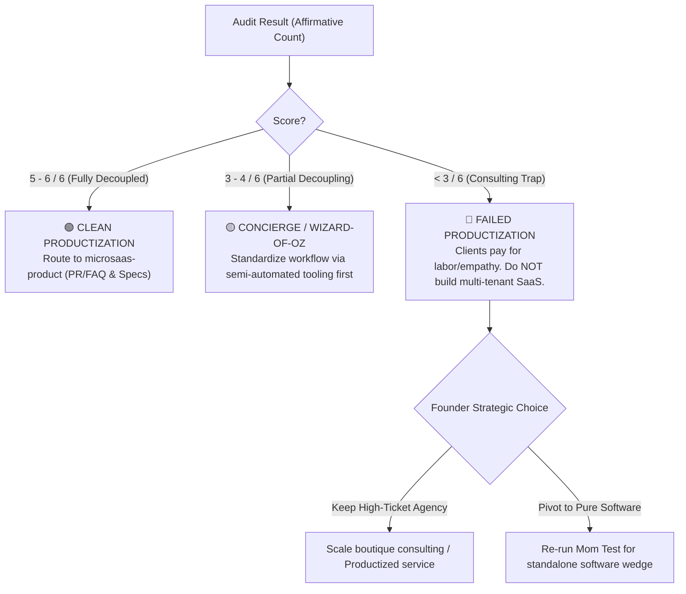

# Service-to-Software Productization Audit (Route C)

> **The Founder Trap:** "I have 4 paying consulting/agency clients who pay me $2,000/month for this workflow. That proves my SaaS idea has product-market fit! Let's start coding immediately!"  
> **The Cold Reality:** In 80% of consulting-to-SaaS failures, the clients were paying for **founder charisma, accountability, customized advice, and someone else doing the work**, NOT a self-serve software tool. If you hand them a login screen, they churn immediately.

---

## 1. Context & Baseline Traction

* **Venture ID:** `[e.g., vnt_2026_001]`
* **Current Service Model:** `[e.g., Fractional CFO, SEO Agency, Webhook integration consultancy]`
* **Number of Active Paying Clients:** `[e.g., 4 clients @ $1,500/mo]`
* **Current Delivery Method:** `[e.g., 80% manual spreadsheets + 20% custom scripts]`
* **Proposed SaaS Product:** `[e.g., Self-serve automated dashboard for $99/mo]`

---

## 2. The 6 Forcing Productization Questions

Every affirmative response must be backed by documented evidence in `.microsaas/source-ledger.md`.

| # | Diagnostic Question | Honest Reality Check | Verified (Yes/No) | 4D Evidence Reference |
| :-: | :--- | :--- | :---: | :--- |
| **Q1** | **Value Source:** What are clients *really* paying for? | Are they paying for the mechanical data transformation, or for the founder's judgment, accountability, and customized advisory? | `[Yes/No]` | `[e.g., LEDGER-EV-01]` |
| **Q2** | **Repeatability:** Is the workflow 90%+ standardized? | Do all clients use the identical data format, business rules, and output, or does every client require bespoke manual exceptions? | `[Yes/No]` | `[e.g., LEDGER-EV-02]` |
| **Q3** | **Labor Decoupling:** Can human intervention be removed without degrading perceived value? | Can a user self-onboard and receive immediate value without founder onboarding calls or manual backend fixes? | `[Yes/No]` | `[e.g., LEDGER-EV-03]` |
| **Q4** | **Founder Absence:** If the founder vanished for 60 days, would the client still derive 100% of the value? | If you stop answering client Slack messages, do they continue paying and using the software? | `[Yes/No]` | `[e.g., LEDGER-EV-04]` |
| **Q5** | **Software-Only Willingness to Pay:** Will clients pay for software alone at a viable price point? | Have you explicitly asked: *"If I give you software that does X for $199/mo, but I no longer do your weekly calls, will you subscribe?"* | `[Yes/No]` | `[e.g., LEDGER-EV-05]` |
| **Q6** | **Zero-Human Outcome Equivalence:** Does the automated tool deliver equal or superior results? | Does the automated script produce an output that clients accept with zero manual touch-ups or human quality checks? | `[Yes/No]` | `[e.g., LEDGER-EV-06]` |

---

## 3. Productization Feasibility Score

* **Total Affirmative Responses (Yes):** `[0 to 6]` / 6

### Strategic Routing Rules:

---

## 4. Audit Findings & Required Action

* **Primary Failure Risk Identified:** `[e.g., Clients require custom ERP integrations that cannot be standardized without massive dev cost]`
* **Selected Pathway:**
  - [ ] **Pathway A (Pure SaaS Advance):** 5-6/6 verified. Proceed directly to Spec-Driven Development (`microsaas-product`).
  - [ ] **Pathway B (Concierge / Hybrid MVP):** 3-4/6 verified. Package a standardized 1-workflow prototype operated manually by founder to prove self-serve viability.
  - [ ] **Pathway C (Productized Service):** <3/6 verified. Halt SaaS build. Productize service pricing or pivot to a different customer segment who actually wants software.
